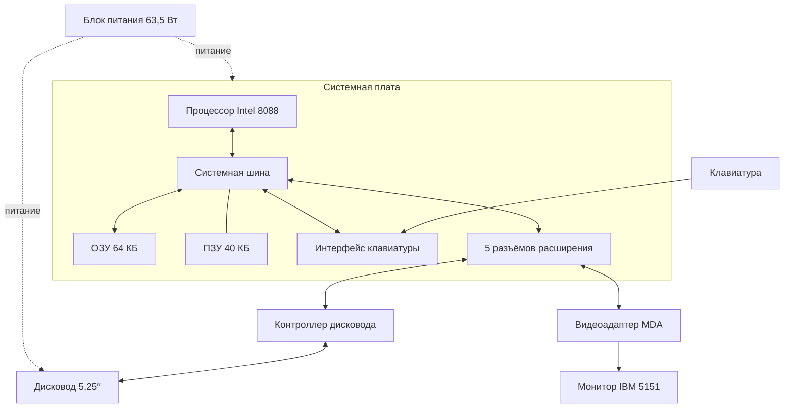

# ДЗ № 1. Устройство IBM PC 5150

Выбран IBM PC 5150. Этот компьютер выпустили в 1981 году. Я рассмотрел вариант с 64 КБ оперативной памяти, одним дисководом и монохромным монитором.

## Схема подключения компонентов

## Компоненты компьютера

| Компонент | Характеристики и назначение |
| --- | --- |
| Системная плата | На ней находятся процессор, память и разъёмы для дополнительных плат. Ранняя версия поддерживает от 16 до 64 КБ оперативной памяти. |
| Процессор Intel 8088 | Выполняет команды программ. Частота составляет 4,77 МГц. У него 16-битные регистры и 8-битная внешняя шина данных. Через 20-битную адресную шину он может обращаться к памяти в пределах 1 МБ. |
| Системная шина | По ней процессор передаёт адреса и сигналы управления, а также обменивается данными с памятью и устройствами. |
| Оперативная память (ОЗУ) | В этом варианте установлено 64 КБ динамической памяти с проверкой чётности. В ОЗУ находятся программы и данные, с которыми компьютер работает в данный момент. После выключения они пропадают из ОЗУ. |
| Постоянная память (ПЗУ) | Всего 40 КБ. Из них 8 КБ занимает BIOS и 32 КБ занимает Cassette BASIC. BIOS проверяет оборудование при включении компьютера. |
| Интерфейс клавиатуры | Принимает коды с клавиатуры, чтобы процессор мог их прочитать. |
| Разъёмы расширения | На плате есть пять разъёмов с 8-битной шиной данных. В них можно установить, например, видеоадаптер или контроллер дисковода. |
| Контроллер дисковода | Управляет чтением и записью дискет. К нему можно подключить до двух внутренних дисководов. |
| Дисковод | Работает с дискетами 5,25 дюйма. В выбранном варианте на одну дискету помещается 160 КБ. На ней можно хранить программы и файлы. |
| Видеоадаптер MDA | Передаёт текст на монитор. На экране помещается 25 строк по 80 символов. У адаптера 4 КБ видеопамяти. |
| Монитор IBM 5151 | 12-дюймовый монитор с электронно-лучевой трубкой. Показывает зелёные символы на тёмном фоне. |
| Клавиатура | Имеет 83 клавиши. При нажатии или отпускании клавиши отправляет её код компьютеру. |
| Блок питания | Мощность составляет 63,5 Вт. Блок питания подаёт на детали системного блока напряжения +5 В, -5 В, +12 В и -12 В. |

## Как компьютер загружается

Когда компьютер включается, процессор запускает BIOS из постоянной памяти. BIOS проверяет оборудование. Если в дисководе есть загрузочная дискета, BIOS читает с неё загрузочный сектор и помещает его в ОЗУ. Затем процессор выполняет код из этого сектора, и начинается загрузка операционной системы.

## Источники

- [История IBM PC на сайте IBM](https://www.ibm.com/history/personal-computer)
- [Техническое руководство IBM PC 5150, 1981 год](https://www.minuszerodegrees.net/manuals/IBM/IBM_5150_Technical_Reference_6025005_AUG81.pdf)

