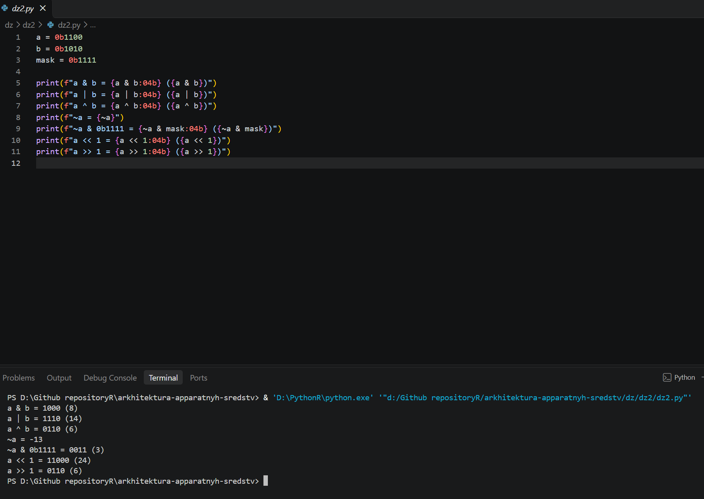

# ДЗ №2. Биты и байты

## Логические выражения

Результаты выражений как F1, F2 и F3. В таблице 0 означает ложь, а 1 - истину.

1. F1 = ¬(A ∧ B) ∨ ¬(A ∨ C). По закону де Моргана получаю (¬A ∨ ¬B) ∨ (¬A ∧ ¬C). По закону поглощения это упрощается до ¬A ∨ ¬B. Результат равен 0 только тогда, когда A и B одновременно равны 1.
2. F2 = (A ∧ B) ∨ (¬B ∧ C). Если B = 1, получается F2 = A. Если B = 0, получается F2 = C.
3. F3 = (A ∧ B) ∨ ¬C. Если C = 0, результат всегда равен 1. Если C = 1, результат равен A ∧ B.

| A | B | C | F1 | F2 | F3 |
|---|---|---|----|----|----|
| 0 | 0 | 0 | 1 | 0 | 1 |
| 0 | 0 | 1 | 1 | 1 | 0 |
| 0 | 1 | 0 | 1 | 0 | 1 |
| 0 | 1 | 1 | 1 | 0 | 0 |
| 1 | 0 | 0 | 1 | 0 | 1 |
| 1 | 0 | 1 | 1 | 1 | 0 |
| 1 | 1 | 0 | 0 | 1 | 1 |
| 1 | 1 | 1 | 0 | 1 | 1 |

## Эксперимент в Python

Взяты числа 12 и 10. В двоичном виде это `1100` и `1010`. Формат `04b` выводит двоичное число минимум с четырьмя позициями и добавляет нули слева, если нужно.

```python
a = 0b1100
b = 0b1010
mask = 0b1111

print(f"a & b = {a & b:04b} ({a & b})")
print(f"a | b = {a | b:04b} ({a | b})")
print(f"a ^ b = {a ^ b:04b} ({a ^ b})")
print(f"~a = {~a}")
print(f"~a & 0b1111 = {~a & mask:04b} ({~a & mask})")
print(f"a << 1 = {a << 1:04b} ({a << 1})")
print(f"a >> 1 = {a >> 1:04b} ({a >> 1})")
```

Вывод программы

```text
a & b = 1000 (8)
a | b = 1110 (14)
a ^ b = 0110 (6)
~a = -13
~a & 0b1111 = 0011 (3)
a << 1 = 11000 (24)
a >> 1 = 0110 (6)
```



Операция `&` оставляет единицы в позициях, где они есть у обоих чисел. Операция `|` ставит единицу, если она есть хотя бы у одного числа. Операция `^` ставит единицу там, где биты различаются.

В Python `~a` равно `-a - 1`, поэтому для числа 12 я получил -13. Маска `0b1111` оставила только четыре младших бита, и получилось `0011`. Сдвиг влево на один бит умножил 12 на 2, а сдвиг вправо дал целую часть от деления на 2.
