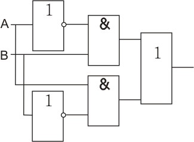
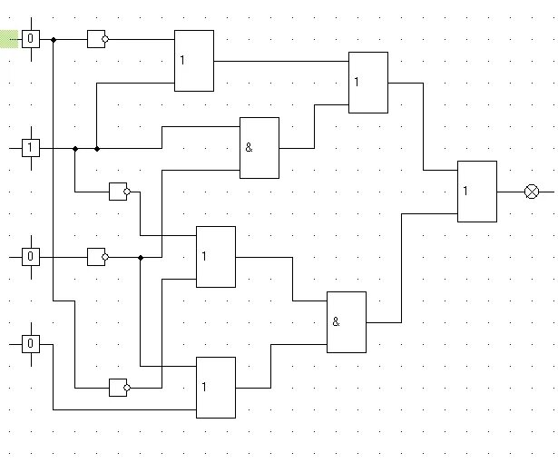
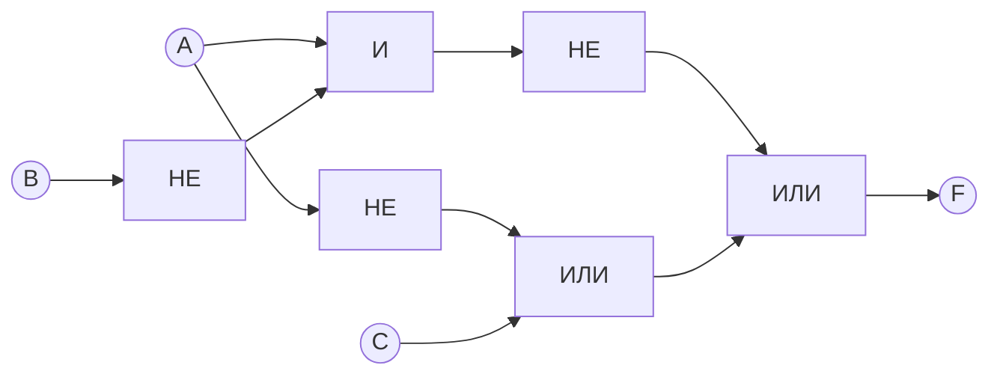
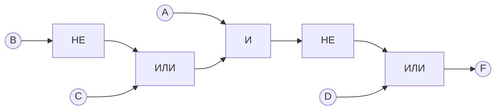

# ДЗ №3. Логические схемы и формулы

## 1. Из схемы в формулу

На схемах блок `&` означает И, блок `1` с несколькими входами - ИЛИ, а кружок на выходе блока с одним входом - НЕ. Записал выражения для отдельных ветвей и объединил их по последнему элементу схемы.

### Схема 1

- Верхний элемент И получает `¬A` и `B`.
- Нижний элемент И получает `A` и `¬B`.
- Последний элемент ИЛИ объединяет выходы этих двух элементов.

Получается **F = (¬A ∧ B) ∨ (A ∧ ¬B)**. Это исключающее ИЛИ. На выходе единица, когда A и B различаются.

### Схема 2

Обозначил входы сверху вниз буквами A, B, C и D.

- В верхней ветви первый элемент ИЛИ даёт `¬A ∨ B`, а элемент И даёт `B ∧ ¬C`. Их выходы сходятся на элементе ИЛИ.
- В нижней ветви два элемента ИЛИ дают `¬B ∨ ¬A` и `¬C ∨ D`. Их выходы сходятся на элементе И.
- Последний элемент ИЛИ объединяет верхнюю и нижнюю ветви.

Получается **F = ((¬A ∨ B) ∨ (B ∧ ¬C)) ∨ ((¬B ∨ ¬A) ∧ (¬C ∨ D))**.

Для значений на рисунке (A = 0, B = 1, C = 0, D = 0) верхняя ветвь даёт 1, нижняя тоже даёт 1. Значит, на выходе F = 1.

## 2. Из формулы в схему

Заменил импликацию по правилу `X → Y = ¬X ∨ Y`. Так обе схемы можно собрать из элементов НЕ, И и ИЛИ.

### Формула 1

**(A ∧ ¬B) → (C ∨ ¬A)**

После замены импликации получаю **F = ¬(A ∧ ¬B) ∨ (C ∨ ¬A)**. Сначала строю левую и правую части. Затем инвертирую левую часть и подаю обе части на последний элемент ИЛИ.

Проверка при A = 1, B = 0, C = 0. Левая часть исходной импликации равна 1, правая равна 0, поэтому F = 0.

### Формула 2

**¬(A ∧ (B → C)) ∨ D**

После замены импликации получаю **F = ¬(A ∧ (¬B ∨ C)) ∨ D**. Сначала получаю `¬B ∨ C` и подаю результат вместе с A на элемент И. Затем инвертирую его выход и объединяю результат с D через ИЛИ.

Проверка при A = 1, B = 1, C = 0, D = 0. Импликация `B → C` равна 0. Элемент И выдаёт 0, после НЕ получается 1, поэтому F = 1.
