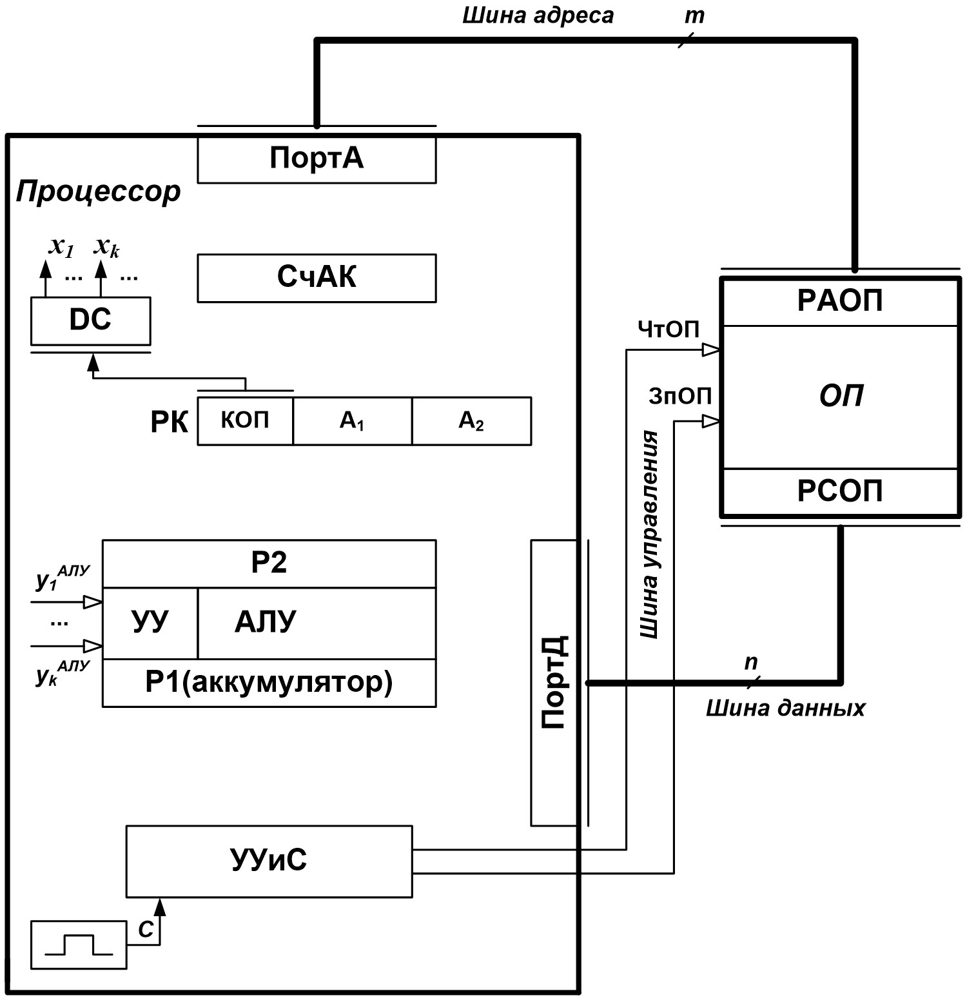
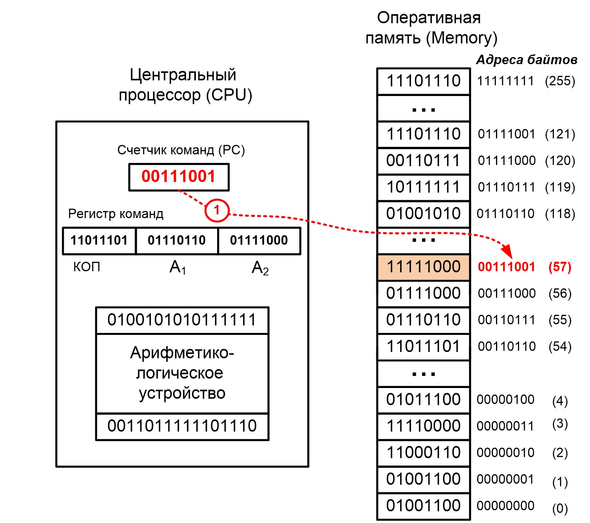
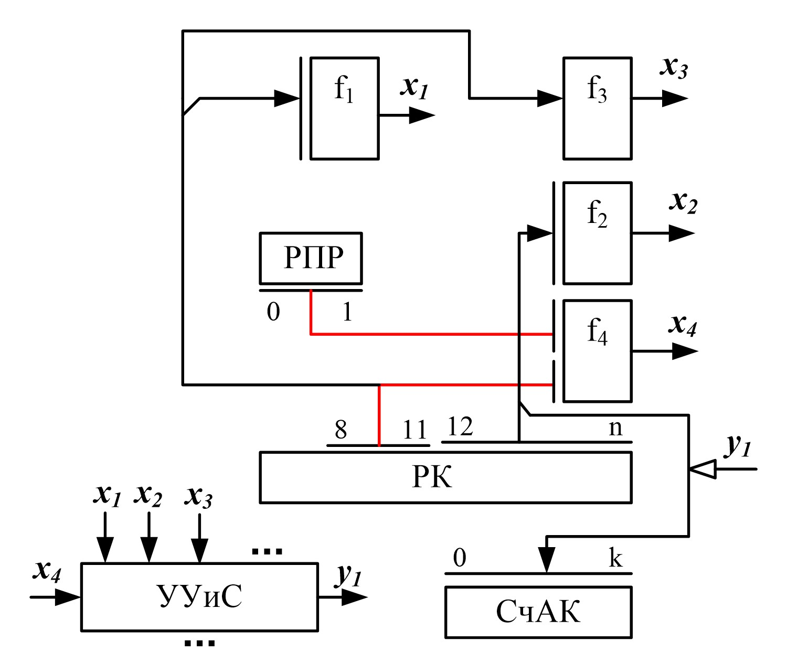
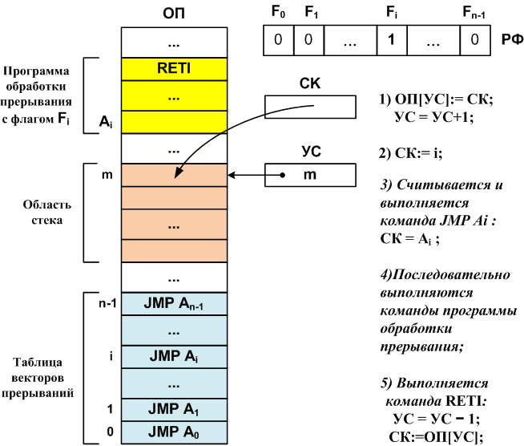

# ДЗ №4. Процессор и его рабочий цикл

Конспект по презентациям «проц теория.ppt» и «проц.pptx».

## 1. Из чего состоит процессор

Процессор считывает команды программы и выполняет их. В памяти и команды, и данные хранятся в виде двоичных кодов. В команде код операции (КОП) задаёт действие, а остальные поля могут указывать, где взять данные и куда записать результат. Набор действий, которые умеет выполнять процессор, называется системой команд.

| Узел | Для чего нужен |
| --- | --- |
| Арифметико-логическое устройство (АЛУ) | Выполняет сложение, логические операции и другие действия над данными. |
| Регистры | Хранят операнды, результаты, адреса и служебные данные внутри процессора. |
| Счётчик команд (СК, или PC) | Хранит адрес команды, которую надо считать из памяти. |
| Регистр команд (РК) | Хранит считанную команду. Дешифратор определяет действие по её КОП. |
| Устройство управления и синхронизации (УУиС) | По тактам подаёт сигналы чтения, записи и запуска операций. |
| Шины | По шине адреса передаётся адрес, по шине данных - команда или данные, по шине управления - сигналы чтения и записи. |

Регистр можно собрать из триггеров, каждый из которых хранит один бит. Комбинационная часть АЛУ выдаёт результат по значениям на входах. Например, в многоразрядном сумматоре перенос из младшего разряда поступает в следующий разряд. Мультиплексор выбирает, какой из нескольких входов подключить к выходу. В схеме с тремя шинами можно одновременно подать из регистров два операнда на АЛУ и по отдельной шине вернуть результат.

На схеме ПортА связан с регистром адреса памяти (РАОП), а ПортД - с регистром слова памяти (РСОП). При чтении процессор выставляет адрес и подаёт сигнал ЧтОП. Память возвращает выбранное слово по шине данных. При записи процессор выставляет адрес и данные, затем подаёт сигнал ЗпОП.

## 2. Как устройство управления выполняет команду

Микрооперация - простое действие за один такт, например перенос значения из регистра на шину. Несколько микроопераций, которые выполняются одновременно, образуют микрокоманду. Последовательность микрокоманд называется микропрограммой.

При жёстком управлении сигналы вырабатывают соединённые между собой логические схемы. Сигналы зависят от кода операции, текущего такта и флагов. При микропрограммном управлении последовательности микрокоманд хранятся в специальной памяти. Дешифратор помогает выбрать начальный адрес нужной микропрограммы.

## 3. Рабочий цикл на примере сложения

В учебном примере команда состоит из трёх байтов. Первый байт содержит КОП, второй и третий - адреса операндов A1 и A2. Восьми бит КОП хватает для 256 разных кодов, а восьмиразрядная шина адреса позволяет адресовать 256 байтов памяти. Команды и данные находятся в общей памяти.

1. **Выборка команды.** Процессор выставляет адрес из СК и читает команду в РК.
2. **Выборка операндов.** Процессор читает данные по адресам A1 и A2 и помещает их в регистры АЛУ Р1 и Р2.
3. **Выполнение операции.** Дешифратор распознаёт сложение. АЛУ складывает операнды и оставляет сумму в Р1 (аккумуляторе). В модели с автономным АЛУ устройство управления ждёт, пока сигнал «занято» сбросится.
4. **Запись результата.** Процессор выставляет адрес A1, передаёт сумму на шину данных и записывает её на место первого операнда. Второй операнд остаётся в памяти.
5. **Переход к следующей команде.** СК увеличивается на длину команды. В примере команда занимает байты с адресами 54, 55 и 56, поэтому следующий адрес равен 57.

Для некоторых операций АЛУ также формирует признак результата. В рассмотренной модели в специальный регистр РПР записываются коды 00 для нуля, 01 для отрицательного результата, 10 для положительного и 11 для переполнения с фиксированной точкой. Отдельные флаги сообщают об исключительных ситуациях, например о делении на ноль.

## 4. Где хранятся операнды

| Архитектура | Как выполняется операция |
| --- | --- |
| Стековая | Операнды берутся с вершины стека, результат помещается обратно. Стек работает по принципу LIFO - последним пришёл, первым вышел. |
| Аккумуляторная | Один операнд уже в аккумуляторе. После операции результат записывается туда же. |
| Регистровая | Команда указывает нужные регистры. В зависимости от системы команд операнд может находиться и в памяти. |
| С выделенным доступом к памяти | Команды обработки работают с регистрами. Для чтения из памяти служит LOAD, для записи - STORE. |

В стековой архитектуре выражение `(a + b) * c` можно записать как `a b + c *`. Сначала в стек кладут `a` и `b` и заменяют их суммой. Затем кладут `c` и умножают его на сумму. В такой записи порядок действий виден без скобок.

## 5. Intel 8086 и команды семейства x86

У 8086 адрес состоит из сегмента и смещения. В CS хранится сегмент кода, в DS - сегмент данных, в SS - сегмент стека, в ES - дополнительный сегмент. Для получения физического адреса значение сегмента умножают на 16 и прибавляют смещение. Например, `B800:0000` указывает на адрес `B8000` в шестнадцатеричной системе.

Регистр FLAGS хранит признаки результата и управляющие флаги. Например, ZF показывает, что результат равен нулю, CF показывает перенос или заём, SF отражает старший бит результата, а OF показывает знаковое переполнение. DF задаёт направление строковых операций, IF управляет разрешением маскируемых внешних прерываний. В 8086 выборка байтов следующих команд может идти одновременно с выполнением текущей команды.

- **Пересылка.** MOV копирует данные, PUSH кладёт значение в стек, POP извлекает его, LEA вычисляет эффективный адрес. IN и OUT работают с портами ввода-вывода.
- **Обработка.** ADD и SUB складывают и вычитают, AND, OR и XOR работают с отдельными битами, CMP сравнивает операнды и обновляет флаги. SHL и SHR выполняют логические сдвиги, SAR при сдвиге вправо сохраняет знак, ROL и ROR выполняют циклические сдвиги.
- **Передача управления.** JMP выполняет безусловный переход. JZ выполняет переход при ZF = 1, JNZ - при ZF = 0. Команда LOOP уменьшает счётчик цикла и выполняет переход, пока счётчик остаётся ненулевым.

Команды x86 имеют переменную длину. Помимо КОП в машинном коде могут быть префикс, байты адресации, смещение и непосредственный операнд. Состав полей зависит от конкретной команды.

## 6. Условный переход и вызов подпрограммы

При обычном выполнении СК продвигается на длину команды. Для ветвления и циклов команда перехода может записать в СК другой адрес. В учебной команде перехода по маске есть КОП, четырёхбитная маска M и адрес A. Каждый бит маски разрешает переход при одном из четырёх значений РПР. Например, если в маске разрешён только нулевой результат, переход к A произойдёт при РПР = 00. При нулевой маске или нулевом адресе переход пропускается. При маске из единиц и ненулевом адресе переход выполняется при любом значении РПР.

В x86 команда CALL сохраняет адрес следующей команды в стеке и передаёт управление подпрограмме. RET извлекает этот адрес и возвращает управление вызывающему коду. При вложенных вызовах первым выполняется возврат из последней вызванной подпрограммы. Параметры можно передавать через регистры, стек или по адресу в памяти.

Стековый кадр нужен для доступа к параметрам, локальным переменным и сохранённым значениям. В типичном кадре x86 регистр BP служит опорой для обращения к этим данным, а SP указывает на вершину стека. Команды ENTER и LEAVE помогают создать и освободить кадр в тех версиях x86, которые их поддерживают.

## 7. Прерывания и возврат к программе

Прерывание может прийти от внешнего устройства или таймера. Исключение возникает при выполнении команды, например при делении на ноль. В учебной модели регистр флагов (РФ) хранит признаки запросов, а регистр масок (РМ) позволяет запретить обработку отдельных маскируемых запросов. Если запросов несколько, порядок их обслуживания может зависеть от приоритета.

В модели со слайдов процессор сохраняет адрес возврата в стеке и обращается к записи таблицы векторов, соответствующей причине прерывания. Запись содержит переход к обработчику. Обработчик выполняет нужные действия и завершает работу командой RETI. Она извлекает адрес возврата из стека, и процессор продолжает прерванную программу. Если обработчик меняет регистры, которые нужны основной программе, их значения сохраняются и восстанавливаются. В некоторых процессорах часть этого состояния сохраняется аппаратно вместе со словом состояния программы (PSW).
