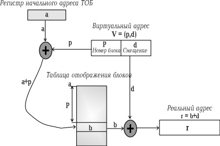

# ДЗ №5. Путь обращения к виртуальной памяти

У каждого процесса есть своё виртуальное адресное пространство. Виртуальная память позволяет загружать нужные части программы и её данных в ОЗУ по мере обращения к ним. Разберу, как это происходит при чтении одного байта в системе со страничной организацией памяти.

## От виртуального адреса к физическому

1. Процессор выполняет команду чтения и вычисляет виртуальный адрес байта. В этом адресе есть номер виртуальной страницы и смещение байта от её начала.
2. Блок управления памятью процессора (MMU) ищет перевод адреса в TLB - кэше недавних преобразований. Если нужная запись есть, MMU берёт из неё номер физического кадра и проверяет права доступа. При промахе TLB процессор обращается к таблицам страниц текущего процесса.
3. Запись таблицы страниц указывает, находится ли страница в ОЗУ и какие операции с ней разрешены. Если страница присутствует и чтение разрешено, MMU берёт номер физического кадра и прибавляет исходное смещение к адресу начала этого кадра.
4. По полученному физическому адресу процессор читает байт. Если данные уже в кэше процессора, чтение обслуживает кэш. При промахе данные поступают из ОЗУ.

Схема из презентации «Управление памятью», слайд 94.

## Если страницы нет в ОЗУ

1. При обращении к отсутствующей странице процессор вызывает исключение (page fault) и передаёт управление операционной системе.
2. ОС проверяет, выделен ли этот участок памяти процессу и разрешено ли чтение. При допустимом обращении ОС выделяет физический кадр. Если свободных кадров нет, ОС может освободить один из занятых, сохранив его содержимое при необходимости.
3. ОС загружает нужную страницу из файла программы, другого отображённого файла или области подкачки. Для новой пустой страницы ОС может предоставить кадр, заполненный нулями.
4. ОС обновляет таблицу страниц. Процессор повторяет команду чтения и находит страницу в ОЗУ. Если проверка на втором шаге выявила ошибочный адрес или запрет доступа, ОС сообщает процессу об ошибке.

## Пример

Размер страницы в примере - 4096 байт. Процессор читает байт по виртуальному адресу `0x2345`. Деление адреса на `0x1000` даёт номер страницы `0x2`, а остаток `0x345` - смещение.

Пусть в таблице указано, что страница `0x2` находится в физическом кадре `0x9` и доступна для чтения. Начало кадра находится по адресу `0x9000`. Тогда физический адрес байта равен `0x9000 + 0x345 = 0x9345`.

