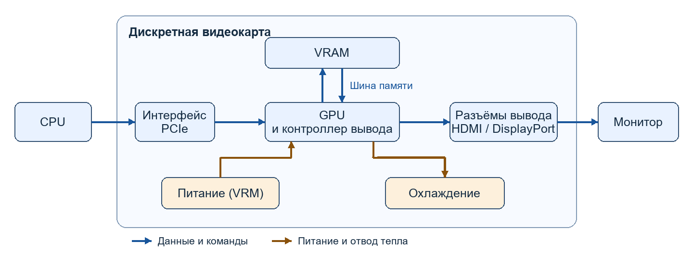

# ДЗ №8. Устройство и работа видеокарты

## 1. Теория

### Пять основных блоков

| Блок | Для чего нужен |
| --- | --- |
| GPU | Выполняет графические команды и параллельные вычисления. |
| VRAM | Хранит текстуры, геометрию, промежуточные данные и готовые кадры. GPU обращается к ней по шине памяти. |
| Подсистема питания (VRM) | Преобразует входное напряжение и поддерживает нужное питание GPU и памяти. |
| Система охлаждения | Отводит тепло от GPU, памяти и элементов питания. |
| Блок ввода-вывода | Через PCIe видеокарта обменивается данными с системой, а через HDMI или DisplayPort передаёт изображение монитору. |

### Два отличия GPU от CPU

1. У CPU обычно сравнительно мало мощных ядер. У GPU много исполнительных блоков, которые одновременно обрабатывают множество потоков. CPU удобно поручать управление игрой и обработку ввода, а GPU - расчёт цвета множества пикселей.
2. CPU старается быстрее выполнить отдельный поток команд. Для этого он предсказывает переходы и может выполнять готовые команды вне очереди. GPU рассчитан на высокий общий темп обработки. Пока одна группа потоков ждёт данные из памяти, он может выполнять другую. Поэтому CPU подходит для цепочек зависимых действий и кода с частыми ветвлениями, а GPU - для обработки больших массивов и умножения матриц.

### Видеопамять

VRAM - память, которой пользуется GPU. На дискретной видеокарте это микросхемы рядом с GPU, соединённые с ним собственной шиной памяти. ОЗУ хранит данные ОС и программ и обслуживается контроллером системной памяти. Встроенный GPU делит ОЗУ с процессором. Высокая пропускная способность нужна, потому что при построении кадра GPU одновременно читает много текстур и других данных и записывает результаты. Если память подаёт данные медленно, часть вычислительных блоков простаивает.

### SIMT и варпы

SIMT означает «одна инструкция, много потоков». Например, одна команда может увеличить яркость сразу у нескольких пикселей, но у каждого потока будут свои исходные данные и свой результат. В GPU NVIDIA потоки выполняются группами по 32, которые называются варпами. Так планировщик выдаёт общую инструкцию сразу группе активных потоков. Если часть потоков попадает в одну ветку условия, а часть в другую, варп выполняет инструкции обеих веток с подходящим набором активных потоков. Из-за этого часть исполнительных блоков временно простаивает. [Документация NVIDIA по SIMT](https://docs.nvidia.com/cuda/cuda-programming-guide/03-advanced/advanced-kernel-programming.html)

### Питание и охлаждение

Подсистема питания поддерживает нужные напряжения даже при резком изменении нагрузки. Радиатор передаёт тепло воздуху, а вентиляторы усиливают обдув. При перегреве GPU снижает частоту, из-за чего падает производительность. Если температура продолжает расти, может сработать защитное отключение.

## 2. Схема дискретной видеокарты



CPU отправляет команды через PCIe. GPU читает ресурсы и записывает кадр через шину памяти. Контроллер вывода в GPU считывает готовый кадр из VRAM и отправляет изображение на монитор через HDMI или DisplayPort.

## 3. Практика

### Графика на моём компьютере

В реестре Windows, в параметре `HardwareInformation.AdapterString`, указано Intel Iris Xe Graphics. Это встроенная графика процессора Intel Core i7-13700H.

| Параметр | Значение |
| --- | --- |
| Объём VRAM | Собственной VRAM нет. GPU использует часть ОЗУ. |
| Тип памяти | Системная память. Процессор поддерживает DDR4, DDR5, LPDDR4x и LPDDR5/x. Установленный тип не подтверждён. |
| Ширина шины | Зависит от конфигурации ОЗУ. У контроллера до двух каналов. Отдельной шины VRAM нет. |
| Вычислительные блоки | 96 исполнительных блоков Intel (EU). |
| TDP | Отдельного значения для встроенного GPU в спецификации нет. Базовая мощность всего процессора - 45 Вт. |

[Характеристики Intel Core i7-13700H](https://www.intel.com/content/www/us/en/products/sku/232128/intel-core-i713700h-processor-24m-cache-up-to-5-00-ghz/specifications.html)

### Расчёт пропускной способности памяти

Для встроенной графики результат зависит от скорости и конфигурации установленного ОЗУ, а общую пропускную способность делят CPU и GPU. Для сравнения с паспортным значением я взял дискретную GeForce RTX 4090. У неё 24 ГБ GDDR6X, шина 384 бита, 16 384 ядра CUDA и мощность всей видеокарты 450 Вт (TGP). [Характеристики GeForce RTX 4090](https://www.nvidia.com/en-us/geforce/graphics-cards/40-series/rtx-4090/)

В формуле под частотой беру эффективную скорость передачи. Для RTX 4090 это 21 Гбит/с на линию, то есть 21 000 Мбит/с на линию. За одну передачу по всей шине проходит 384 / 8 = 48 байт.

```text
21 000 × 384 / 8 = 1 008 000 МБ/с
1 008 000 / 1000 = 1008 ГБ/с
```

Расчёт совпал с паспортным значением NVIDIA - 1008 ГБ/с. Это теоретический максимум. [Спецификация NVIDIA Ada, приложение A](https://images.nvidia.com/aem-dam/Solutions/Data-Center/l4/nvidia-ada-gpu-architecture-whitepaper-V2.02.pdf)

### От запуска игры до первого кадра

1. После нажатия кнопки ОС запускает процесс игры. CPU начинает выполнять её код, а нужные файлы считываются с накопителя в ОЗУ.
2. Игра и графический драйвер подготавливают команды для GPU. Текстуры и модели для дискретной карты загружаются в VRAM через PCIe.
3. CPU обновляет состояние игрового мира и передаёт GPU команды для рисования сцены, например координаты объектов и положение камеры.
4. GPU обрабатывает вершины, определяет, какие пиксели покрывает геометрия, и вычисляет их цвет с учётом текстур и освещения. Готовый кадр он записывает в буфер в VRAM.
5. Контроллер вывода считывает буфер кадра и передаёт сигнал по HDMI или DisplayPort, после чего монитор показывает изображение. На встроенной графике ресурсы и буферы находятся в общей ОЗУ.

## 4. Вывод

В играх GPU одновременно рассчитывает много пикселей, а в ИИ выполняет похожие по структуре операции над большими массивами чисел. Например, при умножении матриц можно параллельно считать элементы результата. Благодаря этому GPU ускоряет и обучение нейросетей, и получение ответов от уже обученных моделей. Быстрая память помогает вовремя подавать вычислительным блокам веса модели и промежуточные данные.
