### Задача 1. Навигация по основным разделам

В графическом режиме симулятора ThinkPad P14s Gen 5 последовательно открыл разделы **Main**, **Config**, **Security**, **Startup** и **Restart**.

В разделе **Main** записал:

- Серийный номер устройства - `PF12345`.
- Версия UEFI BIOS - `XXETXXW`.
- Тип процессора - `Intel(R) Core(TM) CPU`.

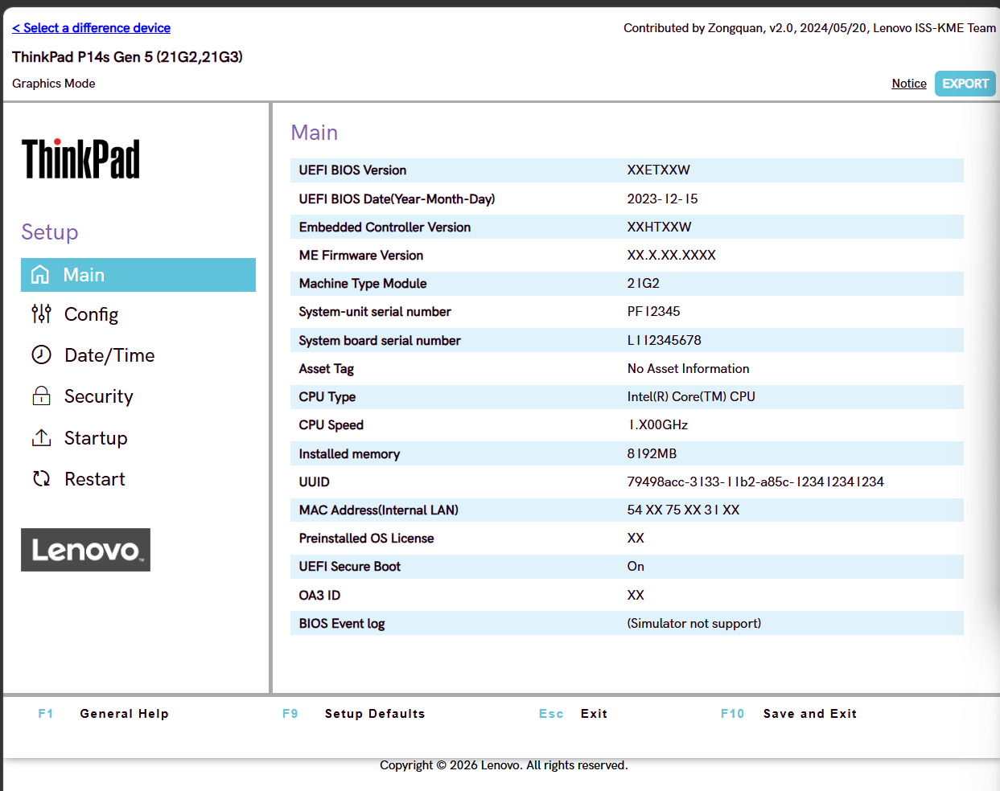

### Задача 2. Смена порядка загрузки

В **Startup → Boot** поставил **USB HDD** первым, а **NVMe0 SKHynix** вторым.

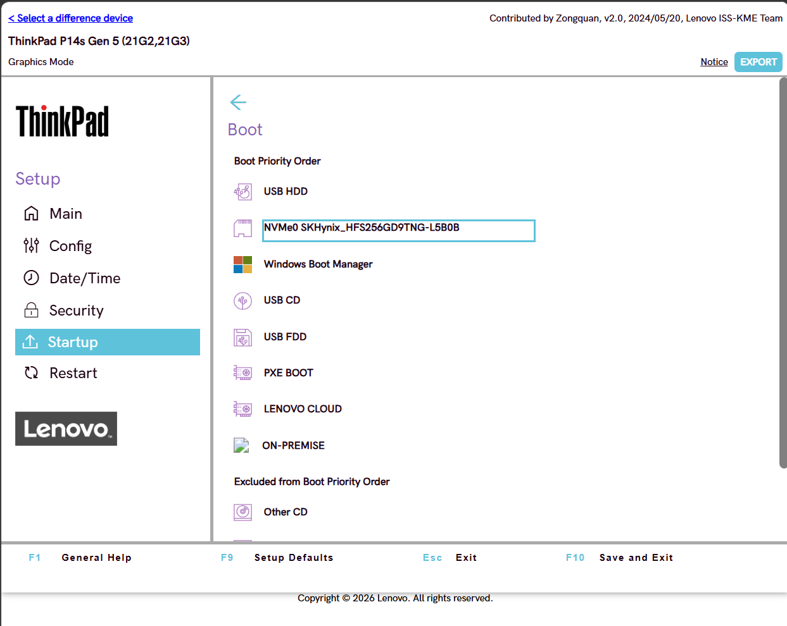

### Задача 3. Включение и выключение Secure Boot

В симуляторе переключил Secure Boot с **On** на **Off** и обратно без перезагрузки. На реальном ПК для применения изменения нужно сохранить настройку в UEFI и перезагрузить компьютер.

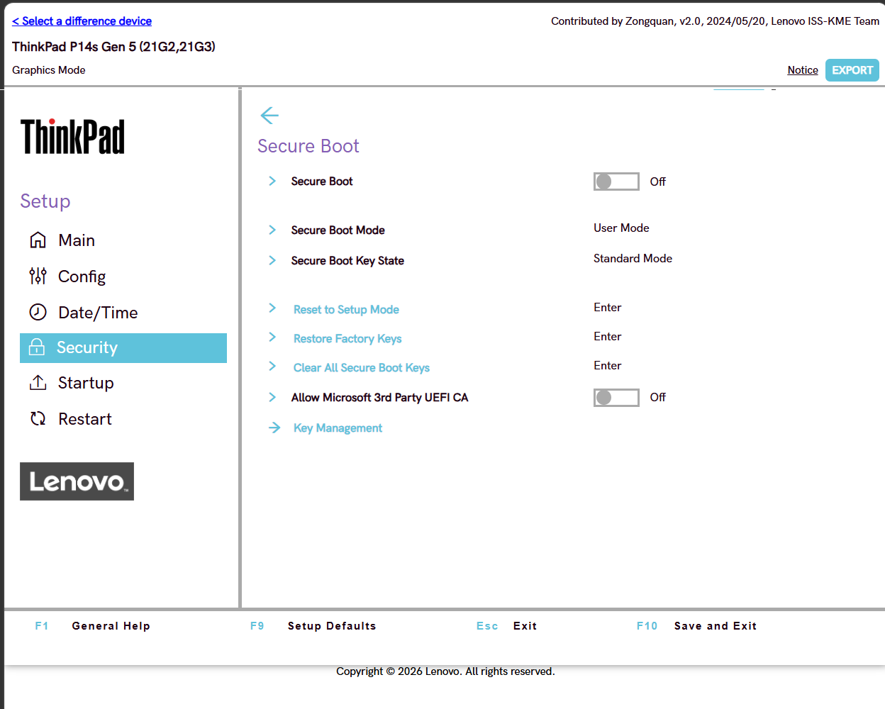

### Задача 4. Установка пароля супервизора
В **Security → Password → Supervisor Password** установил пароль - **Test1234**.

Симулятор показал статус **Enabled**. При изменении настройки запроса пароля
не было. На реальном пк запрос проверяют после сохранения настроек
и повторного входа в UEFI.

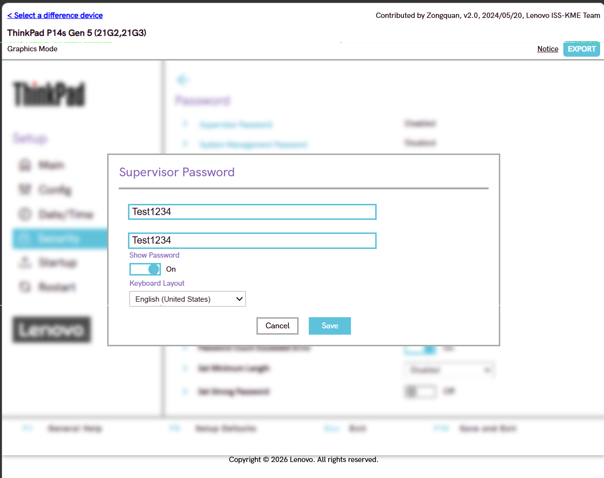

### Задача 5. Сброс на заводские настройки

В меню **Restart** открыл **Setup Confirmation** и нажал **Factory Defaults**,
чтобы сбросить настройки UEFI до заводских. Это же меню можно открыть
клавишей **F9 (Setup Defaults)**.

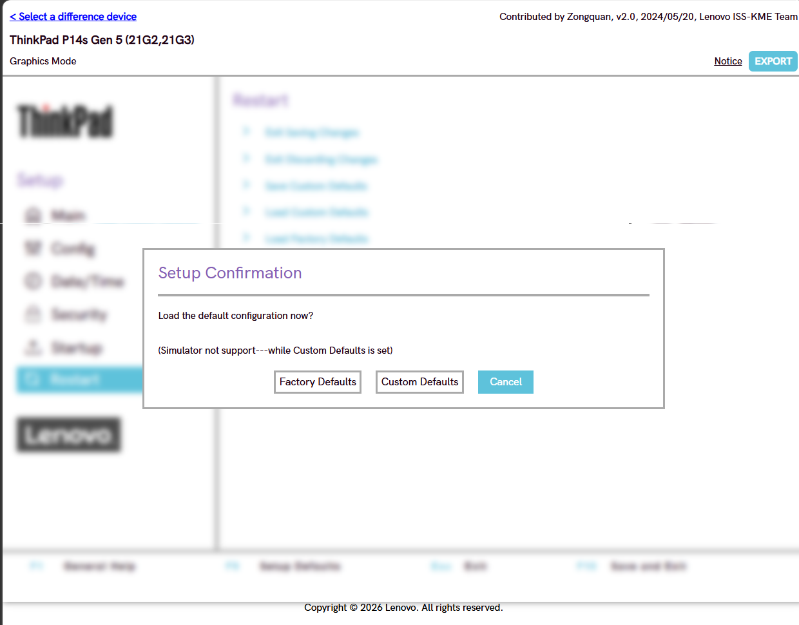

### Задача 6. Управление встроенными устройствами

В **Config → USB → Always On USB** отключил параметр (**Off**)

**Always On USB** позволяет заряжать внешние устройства через совместимый
USB-порт, когда ноутбук выключен или находится в гибернации.

**Гибернация** - режим, при котором компьютер сохраняет текущий сеанс
на накопитель и выключается. При следующем включении открытые программы
и документы восстанавливаются.

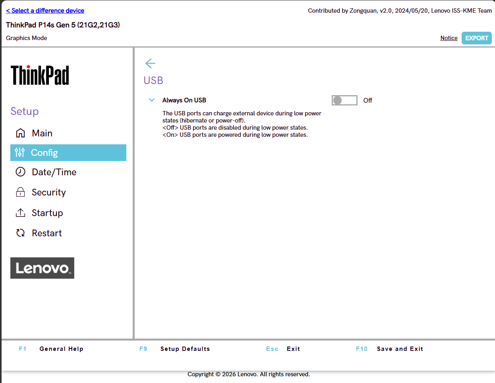

### Задача 7. Режим работы SATA/NVMe

Открыл **Config** в симуляторе ThinkPad P14s Gen 5. Раздела **Storage**
в этом меню нет, поэтому переключение режима контроллера и предупреждения
проверить не удалось.

На реальном ПК смена режима контроллера может привести к ошибке загрузки,
если установленная ОС не может получить доступ к системному диску
через нужный драйвер.

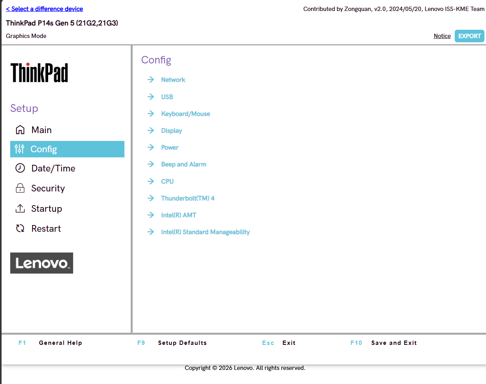

### Задача 8. Временное меню загрузки F12

В **Startup** параметр **Boot device List F12 Option**.
Он уже был включён (**On**).

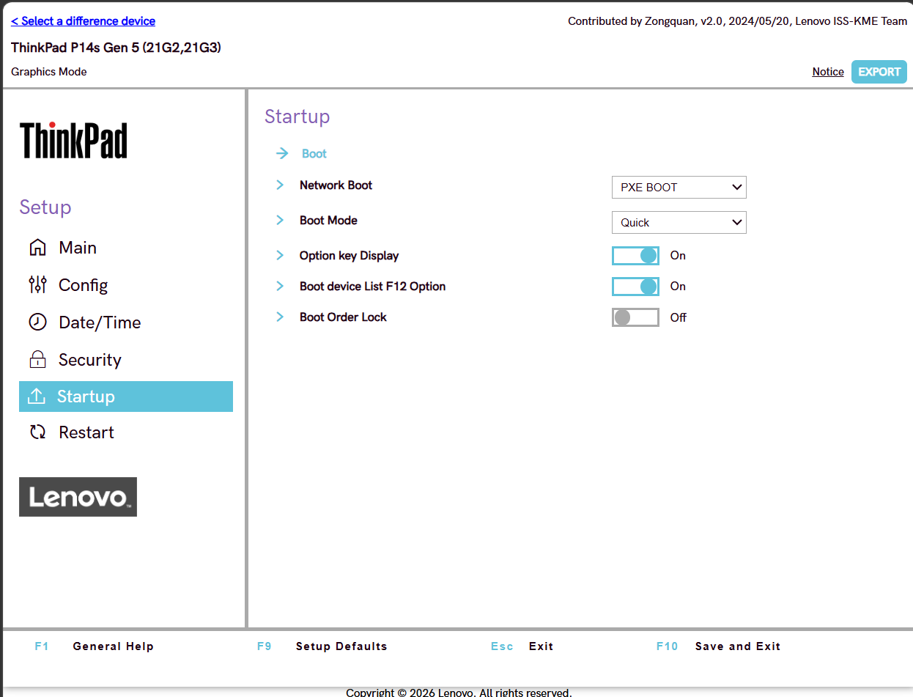

### Задача 9. Просмотр системных логов

В разделе **Main** нашёл строку **BIOS Event log**. Симулятор показывает
сообщение **Simulator not support**, поэтому просмотреть записи и проверить
очистку журнала не удалось.

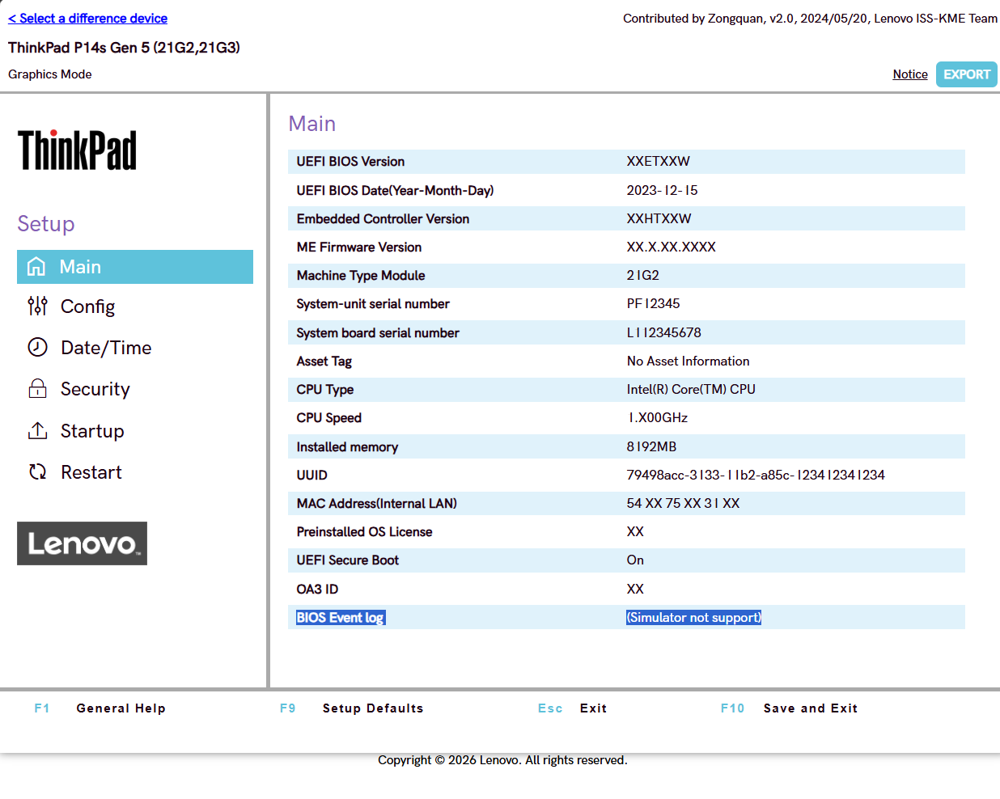

### Задача 10. Подготовка к переустановке ОС

Загрузил **Factory Defaults**, проверил, что **Secure Boot** включён,
установил учебный **Supervisor Password** и поставил **USB HDD** первым
в **Startup → Boot**.

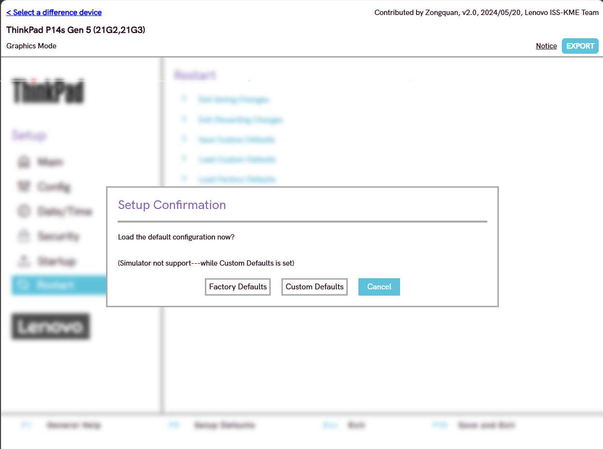

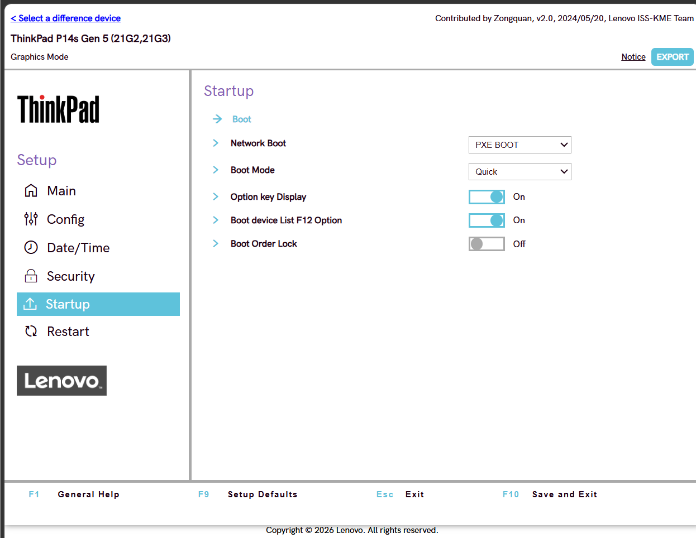

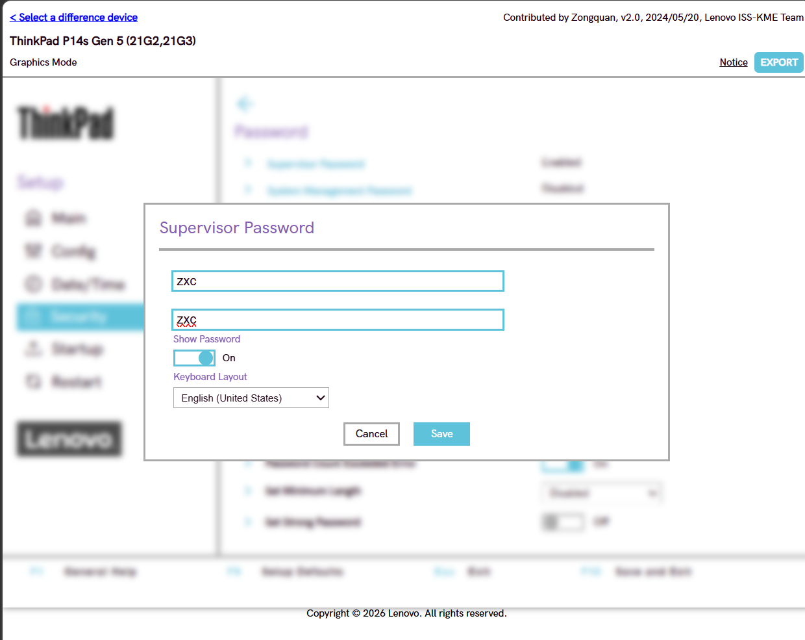

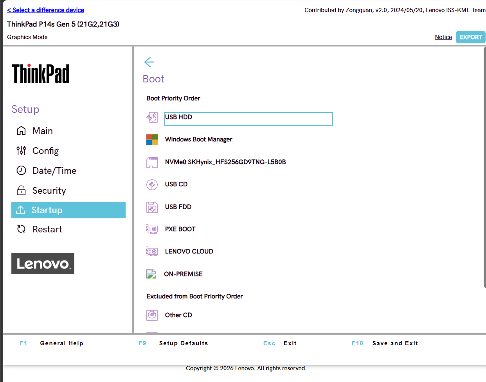